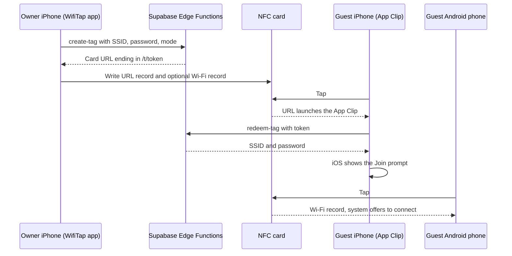

# WifiTap

**Share your Wi-Fi with a tap.** WifiTap writes your network to an NFC card. iPhone guests tap the card and join through an App Clip, with nothing to install. Android guests tap the same card and join with no app at all.

[](LICENSE)


WifiTap is an open-source iOS app, App Clip, and Supabase backend for NFC guest Wi-Fi cards: a tag you can leave on a fridge, a front desk, or a café table. It is written in SwiftUI with CoreNFC and `NEHotspotConfiguration`, and the backend is two Supabase Edge Functions on Postgres. Stored passwords are encrypted with AES-256-GCM, every tap is rate limited and logged, and the backend can revoke a card or let it expire.

> **Status: early development (v0.1.0).** Writing cards and joining from them is implemented and being tested on devices. Owner accounts and a card management screen are not built yet. See [Limitations](#limitations) and [Roadmap](#roadmap).

## Contents

- [How it works](#how-it-works)
- [Security model](#security-model)
- [Repository layout](#repository-layout)
- [Getting started](#getting-started)
- [API](#api)
- [Running tests](#running-tests)
- [Limitations](#limitations)
- [Roadmap](#roadmap)
- [Contributing](#contributing)
- [License](#license)

## How it works



1. **Create.** The owner enters the network in the WifiTap app. The `create-tag` function encrypts the password, stores it, and returns a card URL of the form `https://<TAG_DOMAIN>/t/<token>`. The token is 128 random bits (22 base64url characters).
2. **Write.** The app writes an NDEF message to the card, reads it back, and checks that it matches.
3. **iPhone tap.** iOS reads the URL record and opens the App Clip registered for your domain. The Clip sends the token to `redeem-tag` and passes the network to `NEHotspotConfiguration`, which shows the system join prompt. If the full WifiTap app is installed, the tap opens the app instead of the Clip.
4. **Android tap.** Android reads the Wi-Fi Simple Configuration record (`application/vnd.wfa.wsc`) and offers to connect without any app.

### Card modes

| | iPhone + Android (`url_and_wifi`) | Link only (`url_only`) |
|---|---|---|
| iPhone | Joins through the App Clip | Joins through the App Clip |
| Android | Joins natively, no app needed | Opens the card URL, a web page with instructions (it can't join) |
| Password stored on the card | Yes, readable by any NFC reader app | No, it stays on the server |
| Revoke, expiry, and tap log apply to | iPhone taps only | Every tap |

### Cards

Use NTAG215 or NTAG216 cards. Smaller tags such as NTAG213 may not fit the iPhone + Android mode. The app checks the card's capacity before writing and suggests Link only when the message does not fit.

## Security model

- **Encrypted at rest.** Wi-Fi passwords are stored as AES-256-GCM ciphertext with a random 12-byte IV per password. The key (`TAG_ENC_KEY`) exists only as an Edge Function secret.
- **Clients never see ciphertext.** Column-level grants leave `password_ciphertext` out of every client role. Row level security limits owners to their own cards, and only the `create-tag` function can insert cards.
- **The token is the credential.** `redeem-tag` needs no login, so anyone who has a card's URL can get its password, just as anyone who can tap the card can. Put cards on a guest network, not your main one.
- **Rate limited.** `redeem-tag` serves at most 30 redemptions per card in any 10 minute window, then returns `429`.
- **Logged without identifiers.** Each redemption records the card, the outcome, and a self-reported platform (`ios`, `android`, `web`, or `unknown`). No IP addresses or device identifiers are stored.
- **Not cacheable.** Every function response sends `Cache-Control: no-store`. The card web page also sends `noindex` and `no-referrer`, so card URLs stay out of search engines and referrer headers.
- **Test credentials stay out of Release.** The local test network in `Local.xcconfig` is compiled into Debug builds only.

To report a vulnerability, see [SECURITY.md](SECURITY.md).

## Repository layout

```text
ios/
  project.yml           XcodeGen spec. The .xcodeproj is generated and not committed.
  App/                  WifiTap app: writes cards with CoreNFC
  Clip/                 App Clip: joins a network from a card tap
  Shared/               Used by both: config, API client, Wi-Fi join, NDEF records
  Tests/                Unit tests (Swift Testing)
  Config/               Base.xcconfig and Local.xcconfig.example
supabase/
  migrations/           tags and tag_events tables, grants, row level security
  functions/
    create-tag/         POST, requires a user JWT
    redeem-tag/         GET, the card token is the credential
    _shared/            Encryption, HTTP helpers, service role client
  config.toml           Local stack settings (ports 54620 to 54629)
  .env.example          Template for the Edge Function secrets
web/
  vercel.json           Static site config: headers and the /t/<token> rewrite
  public/
    .well-known/        apple-app-site-association template
    t.html              Page shown when a card URL opens in a browser
docs/
  phase1-test-matrix.md Device test plan for iPhone and Android
```

## Getting started

### Requirements

- A Mac with Xcode 16 or later (Swift 6). The project is tested with Xcode 27.
- [XcodeGen](https://github.com/yonaskolb/XcodeGen): `brew install xcodegen`
- An iPhone with NFC to write and tap cards. The simulator runs the unit tests but has no NFC.
- An Apple Developer Program membership. Associated Domains and App Clips are not available to free personal teams.
- A domain you control for card URLs, served over HTTPS.
- For the backend: the [Supabase CLI](https://supabase.com/docs/guides/local-development/cli/getting-started) and Docker, or a hosted Supabase project.

### 1. Configure the build

```bash
git clone https://github.com/niharnm/WifiTap.git
cd WifiTap
cp ios/Config/Local.xcconfig.example ios/Config/Local.xcconfig
```

Edit `ios/Config/Local.xcconfig` and set `DEVELOPMENT_TEAM`, `BUNDLE_ID_PREFIX`, and `TAG_DOMAIN`. This file is gitignored. Keep it that way, because it holds your team ID, keys, and test network.

### 2. Generate the project and run

```bash
cd ios
xcodegen generate
open WifiTap.xcodeproj
```

Turn on Developer Mode on your iPhone. Run the `WifiTap` scheme once, then the `WifiTapClip` scheme so the App Clip is installed too. Edit `project.yml` rather than the generated project, then run `xcodegen generate` again.

### 3a. Try it without a backend

Leave `SUPABASE_URL` empty and set `LOCAL_TEST_SSID`, `LOCAL_TEST_PASSWORD`, and `LOCAL_TEST_SECURITY` (`wpa2` or `open`) in `Local.xcconfig`. In this mode the app writes cards with a random link, and the App Clip joins the network from `Local.xcconfig` instead of asking a server. It works in Debug builds only. Use a guest network, because the password is compiled into the Debug app.

### 3b. Run the Supabase backend

**Locally**, for working on the functions and schema:

```bash
supabase start
cp supabase/.env.example supabase/functions/.env
# Set TAG_ENC_KEY in supabase/functions/.env to the output of: openssl rand -base64 32
supabase functions serve
```

`supabase start` applies the migrations, and `supabase functions serve` loads `supabase/functions/.env`. The app accepts only `https` URLs for `SUPABASE_URL`, so a phone cannot use the local stack at `http://127.0.0.1:54621` directly. For device testing, use a hosted project or an HTTPS tunnel.

**Hosted:**

```bash
supabase link --project-ref <your-project-ref>
supabase db push
supabase secrets set TAG_ENC_KEY="$(openssl rand -base64 32)" PUBLIC_TAG_BASE_URL=https://tap.yourdomain.com
supabase functions deploy create-tag
supabase functions deploy redeem-tag --no-verify-jwt
```

Then enable anonymous sign-ins in your project's Auth settings. The app signs owners in anonymously until Sign in with Apple lands.

Avoid `supabase config push` unless you need it: it copies the local Auth settings in `supabase/config.toml` to the hosted project. If you use it, first add a `[remotes.<name>]` override with your project ref, as the comment at the end of `config.toml` describes, and keep it out of git.

Keep a copy of `TAG_ENC_KEY` somewhere safe, such as a password manager. If it is lost or changed, every stored password becomes unreadable.

Finally, add the project to `Local.xcconfig`. Write URLs as `https:/$()/host`, because `//` starts a comment in xcconfig files.

```text
SUPABASE_URL = https:/$()/yourproject.supabase.co
SUPABASE_ANON_KEY = your-publishable-key
```

`PUBLIC_TAG_BASE_URL` must equal `https://<TAG_DOMAIN>`. The app refuses to write a card when the server's URL and the app's domain differ.

### 4. Connect the App Clip to your domain

iOS opens the App Clip only for a domain that lists it in an `apple-app-site-association` file. The `web/` folder is a static site that serves this file and the card page.

1. In `web/public/.well-known/apple-app-site-association`, replace `TEAMID` with your team ID and `com.example` with your `BUNDLE_ID_PREFIX`.
2. Deploy `web/` to a static host on `TAG_DOMAIN`. `web/vercel.json` configures Vercel: it serves the file as `application/json` and routes `/t/<token>` to `t.html`. On another host, set up the same content type and route, with no redirects.

During development, register a local experience on your iPhone under **Settings > Developer > App Clips Testing > Local Experiences** with the URL prefix `https://<TAG_DOMAIN>/t/` and the bundle ID `<BUNDLE_ID_PREFIX>.WifiTap.Clip`. For cards that work on any iPhone, publish the app and register an advanced App Clip experience for the same URL prefix in App Store Connect.

## API

Both functions return JSON. Error bodies have the form `{ "error": "<code>" }`.

### `POST /functions/v1/create-tag`

Requires `Authorization: Bearer <user JWT>` (anonymous users are allowed) and `apikey: <anon key>`.

```json
{ "ssid": "Guest", "password": "guest-password", "security": "wpa2", "mode": "url_and_wifi" }
```

- `security` is `open` or `wpa2` (WPA2 or WPA3 Personal). Open networks take no password.
- `mode` is `url_and_wifi` (the default) or `url_only`.
- SSIDs are 1 to 32 bytes. Passwords are 8 to 63 characters.

| Status | Body |
|---|---|
| `201` | `{ "id": "<uuid>", "token": "<token>", "url": "https://<TAG_DOMAIN>/t/<token>" }` |
| `400` | `invalid_json`, `invalid_body`, `invalid_ssid`, `invalid_security`, `invalid_mode`, or `invalid_password` |
| `401` | `unauthorized` |
| `500` | `server_error` |

### `GET /functions/v1/redeem-tag?token=<token>`

Needs no user session. The optional `X-Client-Platform` header (`ios`, `android`, or `web`) is recorded in the tap log.

| Status | Body |
|---|---|
| `200` | `{ "ssid": "Guest", "password": "guest-password", "security": "wpa2" }`, with `password` set to `null` for open networks |
| `404` | `not_found` |
| `410` | `revoked` or `expired` |
| `429` | `rate_limited` |
| `500` | `server_error` |

### Managing cards

Owners read and change their own cards through the Supabase Data API under row level security. They can change `ssid`, `mode`, `status` (set it to `revoked`), and `expires_at`, delete cards, and read `tag_events` for their cards. Selects on `tags` must name columns, because `select=*` includes the password column and is rejected.

## Running tests

```bash
cd ios
xcodegen generate
xcodebuild test -project WifiTap.xcodeproj -scheme WifiTap -destination 'platform=iOS Simulator,name=iPhone 17'
```

Use any installed iPhone simulator; `xcrun simctl list devices available` lists them. The tests cover Wi-Fi credential validation, card URLs and tokens, build configuration, the NDEF message layout, the Wi-Fi Simple Configuration record, and the API client. The Edge Functions have no automated tests yet.

NFC and Wi-Fi joining only work on real phones. The [device test matrix](docs/phase1-test-matrix.md) lists the iPhone and Android checks.

## Limitations

- Supports WPA2 and WPA3 Personal networks and open networks. WEP and Enterprise (802.1X) networks are not supported. WPA3-only networks are untested, and Android may treat the card's Wi-Fi record as WPA2-Personal.
- iOS reports that the join request was accepted, not whether the phone actually connected.
- Owner sessions are anonymous and kept in memory. After the app restarts it signs in as a new anonymous user, so cards written earlier can no longer be managed from the app.
- The app has no screen yet for listing, revoking, or expiring cards. The backend supports all three.
- Link only cards can't join on Android. The card URL opens a page with instructions instead.

## Roadmap

- Sign in with Apple for owner accounts
- A card management screen: list cards, revoke them, set expiry, and view taps

## Contributing

Bug reports, ideas, and pull requests are welcome. Read [CONTRIBUTING.md](CONTRIBUTING.md) before opening a pull request. Please don't include real Wi-Fi passwords, card URLs, or keys in issues: a card URL is enough to read that card's password.

## License

WifiTap is released under the [MIT License](LICENSE).
